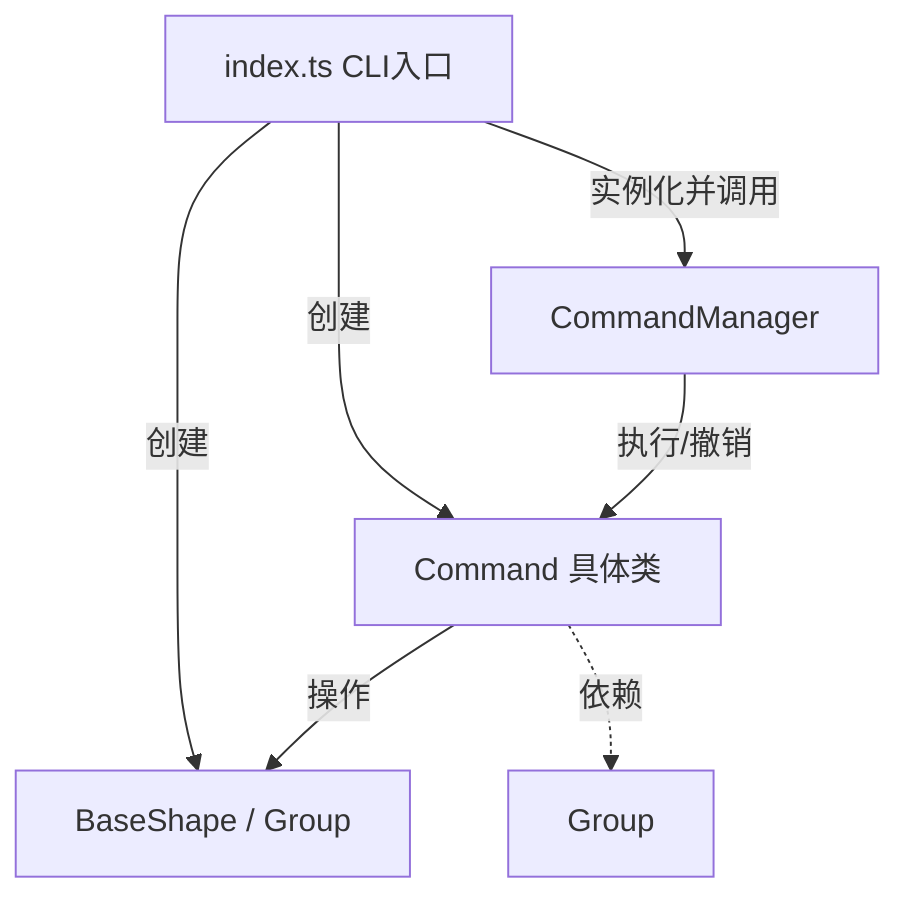

# 架构方案

## 1. 模块划分

本项目代码位于 `src/` 目录下，严格遵循“一类一文件”的面向对象设计原则。模块划分及职责如下：

- **Shape 接口及实现类 (`Shape.ts`, `Group.ts`)**
  - **职责**：定义统一的图形接口 `Shape`，声明 `move`、`scale`、`set`、`toSVG` 等核心操作。`BaseShape` 实现了矩形、圆形、线条等基础叶子节点；`Group` 实现了容器节点。负责底层图形数据的存储、坐标计算与 SVG 标签的序列化。
- **Command 接口及具体命令类 (`Command.ts`)**
  - **职责**：将所有的图形编辑操作封装为独立的命令对象（如 `AddCommand`, `MoveCommand`, `ScaleCommand`, `DeleteCommand`, `GroupCommand`, `UngroupCommand`, `ZOrderCommand`, `AddToCommand`）。每个命令类都实现了 `execute()` 和 `undo()` 方法。
- **命令管理器 (`CommandManager.ts`)**
  - **职责**：维护撤销栈（Undo Stack）和重做栈（Redo Stack），负责接收并执行命令，处理撤销与重做的调度，并在进行 I/O 操作后锁定状态。
- **主程序/解析器 (`index.ts`)**
  - **职责**：CLI 交互入口。负责读取用户输入、解析命令字符串、进行正则校验、路由到对应的具体命令，并在终端输出反馈结果。

**模块依赖关系图 (Mermaid)**：

## 2. 设计模式的选择

本系统严格遵循了以下两种设计模式，彻底杜绝了贫血模型和过程式代码：

**（1）Composite 模式（组合模式）**
- **落地方式**：定义了统一的 `Shape` 接口。`BaseShape` 作为叶子节点，`Group` 作为树枝节点（内部维护 `Shape[]` 列表）。`Group` 同样实现了 `Shape` 接口的 `move`、`scale` 和 `set` 方法，通过递归遍历子节点来实现整体操作。
- **效果**：客户端（即命令类）在调用 `shape.move(dx, dy)` 时，无需关心传入的是单个矩形还是一个复杂的嵌套组合体，统一了操作语义。

**（2）Command 模式（命令模式）**
- **落地方式**：所有编辑操作都被封装为独立的命令类。例如 `MoveCommand` 记录了目标图形和位移增量，`ScaleCommand` 记录了缩放比例，`SetCommand` 记录了修改前后的属性值。`CommandManager` 负责在每次 `execute` 时压入 Undo 栈，在 `undo` 时弹栈并推入 Redo 栈。
- **效果**：彻底解耦了“触发操作”的 CLI 和“执行操作”的图形对象，使得撤销（undo）和重做（redo）功能的实现极其清晰和稳健。

## 3. 依赖方向规则

- **规则**：`index.ts`（UI层）可以依赖 `CommandManager`、`Command` 和 `Shape` 模块；`CommandManager` 仅依赖 `Command` 接口；具体 `Command` 类依赖 `Shape` 接口；`Shape` 实现类处于最底层，不依赖任何上层模块。
- **理由**：确保核心业务逻辑（图形状态变化与撤销逻辑）不依赖于命令行输入输出等外部 I/O 细节，符合依赖倒置原则（DIP）。

## 4. 变化点假设

- **未来可能增加更多图形类型（如多边形 `polygon`）**：
  - *预留措施*：提取了 `Shape` 统一接口，并在 `index.ts` 中预留了工厂分派。未来只需新增具体类实现接口，无需修改命令类。
- **未来可能增加更复杂的属性修改（如渐变色、透明度）**：
  - *预留措施*：基于 Command 模式，只需扩展 `SetCommand` 的白名单，或新增 `SetGradientCommand`，并在 `CommandManager` 中注册即可，无需改动核心执行器。
- **未来可能从 CLI 转变为 GUI 界面**：
  - *预留措施*：业务逻辑全封装在 Command 和 Shape 中，UI 层只需将按钮点击事件转换为对应的 `Command` 对象并传给 `CommandManager` 即可，完全复用底层代码。

# 过程记录

在项目初期，由于经验不足，一开始试图将所有图形逻辑和判断写在 `index.ts` 中，使用了大量的 `switch-case` 进行类型分发。AI 助手指出这种做法属于典型的“贫血模型”和过程式代码，严重违反了面向对象设计原则。

在 AI 的引导下，我们将代码重构为“一类一文件”，引入了多态和 Composite 模式。在实现撤销（undo）功能时，AI 建议不要使用全量快照备份（极耗费内存），而是应用 **Command 模式**，记录每次操作的差异并通过反向执行来实现。经过几次迭代，还逐步完善了 `read` 时的异常处理、`I/O` 操作后的锁栈机制，最终成功搭建了目前这套基于 `CommandManager` 的完整撤销重做架构。

# 一致性自查

1. **模块划分**：实际的 `src/` 目录完全按照架构方案建立（包含 `Shape.ts`, `Command.ts`, `CommandManager.ts`, `Group.ts`, `index.ts`），严格遵守了“一类一文件”的约定。
2. **依赖方向**：通过检查代码，`index.ts` 导入了 Command 和 Shape 类，而 Shape 类本身没有任何来自上层的导入，依赖方向与方案完全一致，无循环依赖。

# 质量保证手段

1. **集成测试**：通过在 CLI 终端中手动输入一整套涵盖所有命令的测试序列进行黑盒测试。验证了 `create` (含 `in` 子句)、`move`、`scale`、`set`、`undo/redo`、`group/ungroup`、`addto`、`front` 等命令均能正确改变程序状态，并且 `undo` 能完美回溯。
2. **序列化与反序列化测试**：通过 `save test.svg` 并立即 `read test.svg`，确认生成的 XML 标签结构合法，且读取解析不报错。
3. **代码审查**：确认代码中没有出现全局公共数据袋，所有状态（如 Undo 栈、Shape 坐标）均被封装在类的私有属性中，符合面向对象规范。
