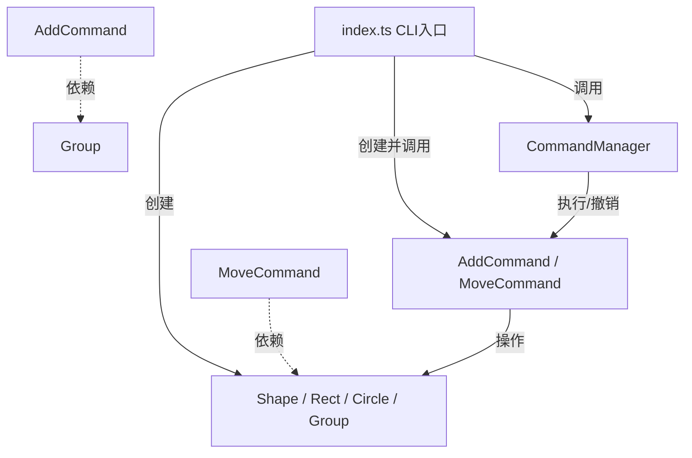

# 架构方案

## 1. 模块划分

本项目代码位于 `src/` 目录下，遵循“一类一文件”的设计原则。模块划分及职责如下：

- **Shape 接口及实现类 (`Shape.ts`, `Rect.ts`, `Circle.ts`, `Group.ts`)**
  - **职责**：定义图形的统一接口 `Shape`，并实现具体的图形类（矩形、圆形）以及容器类（组合 `Group`）。负责图形的属性存储、坐标移动及 SVG 字符串的序列化。
- **Command 接口及实现类 (`Command.ts`, `AddCommand.ts`, `MoveCommand.ts`)**
  - **职责**：将所有的图形编辑操作封装为独立的命令对象，提供 `execute()` 和 `undo()` 方法，用于实现撤销与重做。
- **命令管理器 (`CommandManager.ts`)**
  - **职责**：维护撤销栈（Undo Stack）和重做栈（Redo Stack），负责接收并执行命令，处理撤销与重做的逻辑。
- **主程序/解析器 (`index.ts`)**
  - **职责**：CLI 交互入口。负责读取用户输入，解析命令字符串，通过工厂逻辑创建具体的图形和命令，并调用 `CommandManager` 执行。

**模块依赖关系图 (Mermaid)**：

## 2. 设计模式的选择

本系统严格遵循了以下两种设计模式，以避免贫血模型和过程式代码：

**（1）Composite 模式（组合模式）**
- **落地方式**：定义了统一的 `Shape` 接口。`Rect` 和 `Circle` 作为叶子节点实现该接口；`Group` 作为树枝节点，内部维护一个 `Shape[]` 列表，并且自身也实现 `Shape` 接口。
- **效果**：在 `MoveCommand` 中调用 `shape.move(dx, dy)` 时，如果传入的是单个图形，则移动自身；如果传入的是 `Group`，则会递归调用其内部所有子图形的 `move` 方法。客户端（命令类）无需关心当前操作的是单个图形还是一个复杂的组合体。

**（2）Command 模式（命令模式）**
- **落地方式**：将用户的编辑操作封装为独立的类。例如 `MoveCommand` 保存了目标图形对象、移动的 dx 和 dy。其 `execute()` 方法执行移动，`undo()` 方法反向移动相同的距离。`CommandManager` 负责在每次 `execute` 时压入 Undo 栈，在 `undo` 时弹栈并推入 Redo 栈。
- **效果**：彻底解耦了“触发操作”的 CLI 和“执行操作”的图形对象，使得撤销和重做的实现变得极其清晰。

## 3. 依赖方向规则

- **规则**：`index.ts`（UI层）可以依赖 `CommandManager`、`Command` 和 `Shape`；`CommandManager` 仅依赖 `Command` 接口；`Command` 具体类依赖 `Shape` 接口；`Shape` 具体实现类不依赖任何上层模块。
- **理由**：确保核心业务逻辑（图形操作与撤销逻辑）不依赖于命令行输入输出等外部 I/O 细节，符合依赖倒置原则（DIP）。

## 4. 变化点假设

- **未来可能增加更多图形类型（如椭圆、线条）**：
  - *预留措施*：已经提取了 `Shape` 统一接口。未来只需新增 `Ellipse.ts` 实现 `Shape`，并在工厂中增加解析规则，不需修改现有的命令类和管理器。
- **未来可能增加对属性修改（set）和缩放（scale）的需求**：
  - *预留措施*：基于 Command 模式，只需新增 `SetCommand` 和 `ScaleCommand` 实现 `Command` 接口，并在 `CommandManager` 中注册即可，无需改动旧代码。
- **未来可能从 CLI 转变为 GUI 界面**：
  - *预留措施*：因为业务逻辑全部封装在 `Command` 和 `Shape` 中，UI 层只需负责将按钮点击事件转换为对应的 `Command` 对象并传给 `CommandManager` 即可。

---

# 过程记录

在项目初期，由于缺乏经验，一开始试图将所有图形逻辑写在 `index.ts` 里，使用了大量的 `switch-case` 来判断图形类型。这导致了典型的“贫血模型”和过程式代码。
通过引入 AI 助手进行分析，AI 指出这种做法违反了面向对象设计原则。在 AI 的引导下，我们将代码重构为“一类一文件”，引入了多态。
在实现撤销（undo）功能时，AI 建议不要使用备份快照的方式（太耗费内存），而是应用 **Command 模式**，记录每次操作的差异（dx, dy），通过反向执行来实现。经过几次调整，最终成功搭建了基于 `CommandManager` 的撤销重做架构。

# 一致性自查

1. **模块划分**：实际的 `src/` 目录完全按照架构方案中的划分建立（包含 `Shape.ts`, `Command.ts` 等 9 个文件），严格遵守了“一类一文件”的约定。
2. **依赖方向**：通过检查代码，`index.ts` 导入了 Command 和 Shape 类，而 Shape 类本身没有任何来自上层的导入，依赖方向与方案完全一致，无循环依赖。

# 质量保证手段

1. **功能测试**：通过在 CLI 终端中手动输入命令序列进行黑盒测试。验证了 `create` 能正确生成图形，`move` 能平移，`undo` 能恢复到上一状态，`save` 能输出合法的 SVG 文件。
2. **代码审查**：确认代码中没有出现全局变量数据袋，所有状态都被封装在类（如 `CommandManager` 的私有栈、`Shape` 的私有属性）内部。